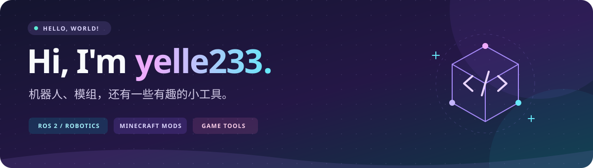
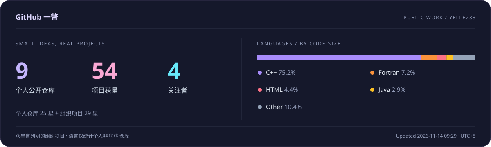

**让想法跑起来，也让游戏更有趣。**

ROS 2 机器人 · Minecraft 模组 · 游戏工具

## 👋 关于我 · About me

你好，我是 **yelle233**，一名**信息安全专业的学生**。

喜欢用代码连通万物，也喜欢用代码给大家带来快乐。这里记录着我的 ROS 2 机器人实践，也放着一些 Minecraft 模组和游戏小工具。

🌱 **正在学习**：`ROS 2` · `SLAM` · `Navigation2`

🔭 **导航前沿探索**：激光惯性里程计（`LIO`）与多传感器融合、`MPPI` 局部规划与动态避障、语义地图与语义导航。

## 🧩 技术与工具 · Tech & tools

## 🚀 项目与实践 · Projects

### 🤖 ROS 2 与机器人

**[RoboMaster 26 赛季哨兵导航](https://github.com/QDU-VRobot/qdu26_sentry_navigation)**

青岛大学未来战队的哨兵导航工程，基于 ROS 2 Humble 与 Nav2，结合 Odin1 重定位、双雷达点云融合和地形分析实现自主导航，在 SMBU PolarBear 开源工程基础上改造。

**[ROS2 导航小车](https://github.com/yelle233/ROS2_navigation_littlecar)**

基于 ROS 2、ESP32-S3 和 micro-ROS，连接上位机与小车底盘，结合 Navigation2 实现运动控制与自主导航。

### 🎮 模组与小工具

- **[VoiceCastAddon](https://github.com/yelle233/VoiceCastAddon)**：在 Minecraft 中用语音触发法术。
- **[Sourceflow Infinite](https://github.com/yelle233/Sourceflow-Infinite)**：围绕流体回收与生产设计的科技模组。
- **[留白 · Liubai](https://github.com/yelle233/Liubai)**：面向大型基地的 Minecraft 客户端渲染优化模组。
- **[InfiniteWater](https://github.com/yelle233/InfiniteWater)**：添加消耗应力、持续产水的机器。
- **[WTKillOverlay](https://github.com/yelle233/WTKillOverlay)**：为《战争雷霆》添加自定义击杀提示与音效。

## 📊 GitHub 一瞥 · At a glance

获星合计包含个人公开仓库与组织下的 [RoboMaster 哨兵导航项目](https://github.com/QDU-VRobot/qdu26_sentry_navigation)，按仓库去重；组织项目星标为整个项目的获星。仓库数量与语言分布仅统计个人账号，语言比例按非 fork 仓库代码字节数计算。

**代码连通世界**

Thanks for stopping by — 欢迎看看我的项目 ✨

